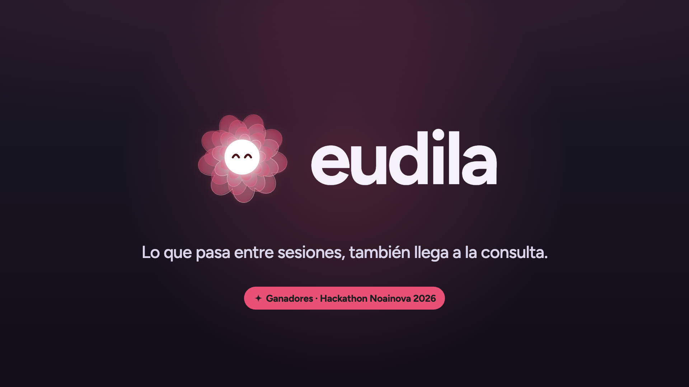
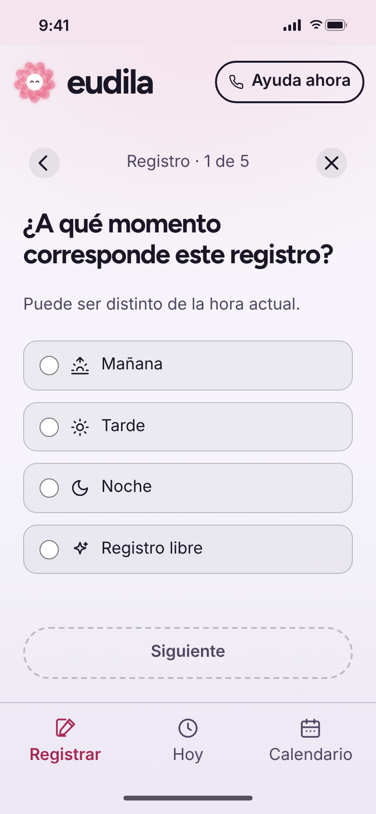
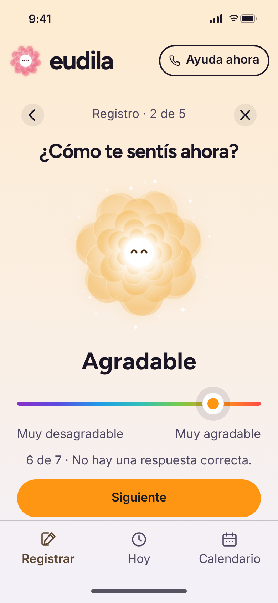
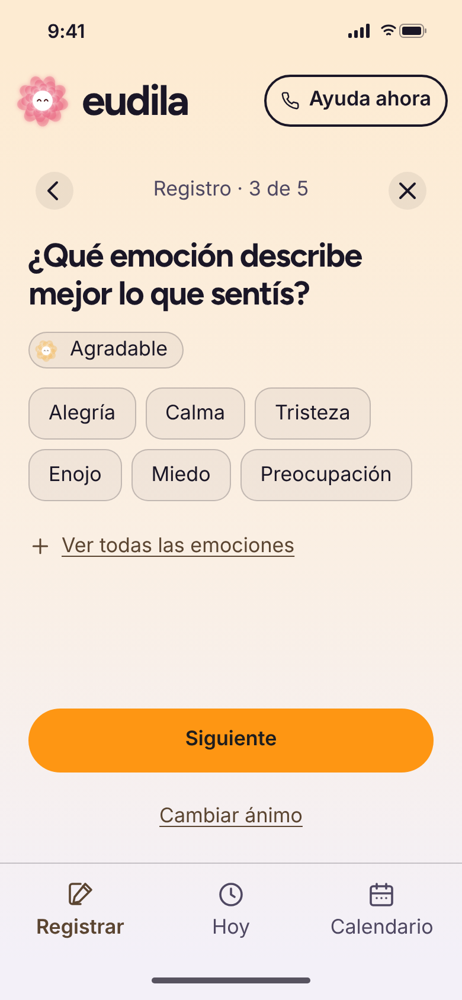
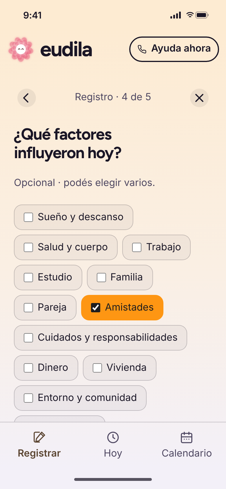
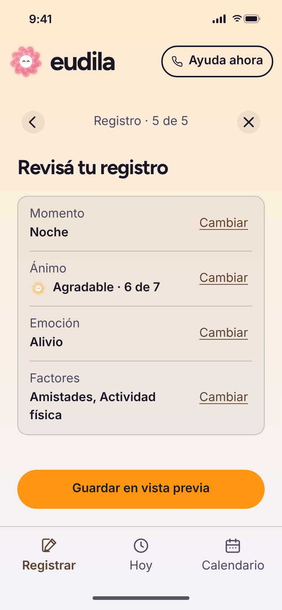
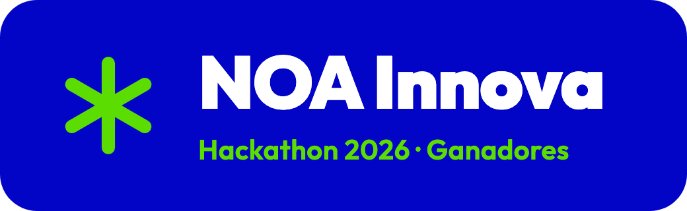

<div align="center">

<a href="https://eudila.com/assets/eudila-film.mp4"></a>

<sub>▶ Tocá la imagen para ver eudila en 30 segundos</sub>

<h3>Registro emocional abierto para pacientes y psicólogos</h3>

<p>
  <a href="https://app.eudila.com"><b>Probar la app</b></a> ·
  <a href="https://eudila.com">Sitio</a> ·
  <a href="app/README.md">Documentación</a>
</p>

<p>
  <a href="https://github.com/Eudila/eudila/actions/workflows/ci.yml"></a>
  <a href="LICENSE"></a>
  
  
  <a href="https://noainnova.com.ar/"></a>
</p>

</div>

## Qué es

**eudila** es una app web para registrar cómo te sentís en cinco pasos cortos. Entre una consulta y la siguiente pasan seis días que el psicólogo no ve; eudila los guarda para que la sesión empiece con datos y no de memoria.

Nació para ayudar a prevenir el suicidio. **No diagnostica:** ordena la información para que un profesional la interprete.

## Para quién

- **Pacientes:** una pausa corta, una pregunta por pantalla. Gratis y de código abierto: cualquiera puede auditar qué pasa con los datos.
- **Psicólogos:** la evolución del ánimo y los factores que se repiten entre sesiones, listos para la consulta.

## Qué hace

<p align="center">
  
  
  
  
  
</p>

- **Registro en cinco pasos:** momento, ánimo (siete estados, de Muy desagradable a Muy agradable), emoción, factores y revisión.
- **Historial:** Hoy, Calendario y detalle de cada día.
- **Evolución y factores:** gráfico de ánimo por día y qué se repite en los días difíciles, sin inventar los días sin registro.
- **Exportación:** informe PDF para la sesión, y CSV o JSON con el historial completo.
- **Ayuda ahora:** teléfonos de emergencia y contención a un toque, también sin conexión.
- **Accesible:** teclado, lectores de pantalla, contraste AA, texto al 200 % y movimiento reducido.

> [!NOTE]
> Las cuentas con email ya funcionan. La sincronización de los registros con la cuenta y el panel para psicólogos están en desarrollo; el panel ya tiene una [vista previa con datos ficticios](dashboard/README.md).

## Probalo en local

Requiere Node.js 22.13+ o 24+.

```sh
git clone https://github.com/Eudila/eudila.git && cd eudila
npm ci
cp app/.env.example app/.env.local
npm run dev
```

Abrí <http://127.0.0.1:3000>. Arranca en vista previa, sin base de datos: los registros viven solo en esa pestaña. Para Supabase local, pruebas de navegador y despliegue, ver el [README de la app](app/README.md).

<details>
<summary><b>Estructura del repositorio</b></summary>

```text
app/          App Next.js: registro, historial, análisis y cuenta (+ Supabase e infra)
landing/      Sitio público estático
dashboard/    Panel del psicólogo: vista previa con datos ficticios
packages/     domain (lógica), mood (mascota y estados), brand (tokens y logos)
docs/         Arquitectura, decisiones, diseño e historia
```

[Arquitectura](docs/arquitectura/README.md) · [Landing](landing/README.md) · [Dashboard](dashboard/README.md)

</details>

<details>
<summary><b>Comprobaciones</b></summary>

```sh
npm run lint
npm run typecheck
npm run format:check
npm test
npm run build
npm run build:dashboard
npm run build:landing
```

CI las ejecuta en Node.js 24 en cada pull request.

</details>

## Lo que viene

- Registros sincronizados con la cuenta y seguridad para datos de salud.
- Panel para psicólogos con todos sus pacientes.
- Integración con Apple Health y Samsung Health.
- Más adelante, alertas tempranas con consentimiento y siempre con un humano decidiendo.

## Reconocimiento

<a href="https://noainnova.com.ar/"></a>

eudila ganó el **Hackathon NOA Innova 2026**, la hackathon regional del Norte Argentino: 48 horas en Salta, en agosto de 2026. Fue la primera validación externa del proyecto y el impulso para llevarlo a los consultorios.

<br clear="right" />

## Equipo

Pablo Cardozo, Agustín Pedernera y Martín Exeni (Ingeniería en Informática) y Noelia Fabbroni (Psicología).

## Licencia

[AGPL-3.0-only](LICENSE). Recursos de terceros en [NOTICE.md](NOTICE.md).

> Si vos u otra persona están en peligro inmediato, llamá al **911**. Para hablar con alguien: **135** (CABA y GBA), **0800 345 1435** (todo el país) o **0800 999 0091** (salud mental, 24 horas).
