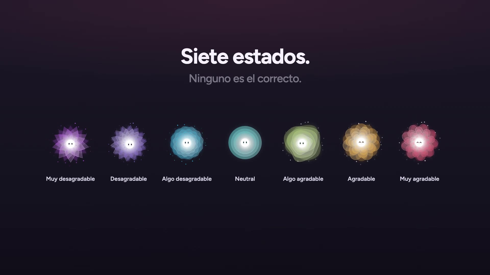
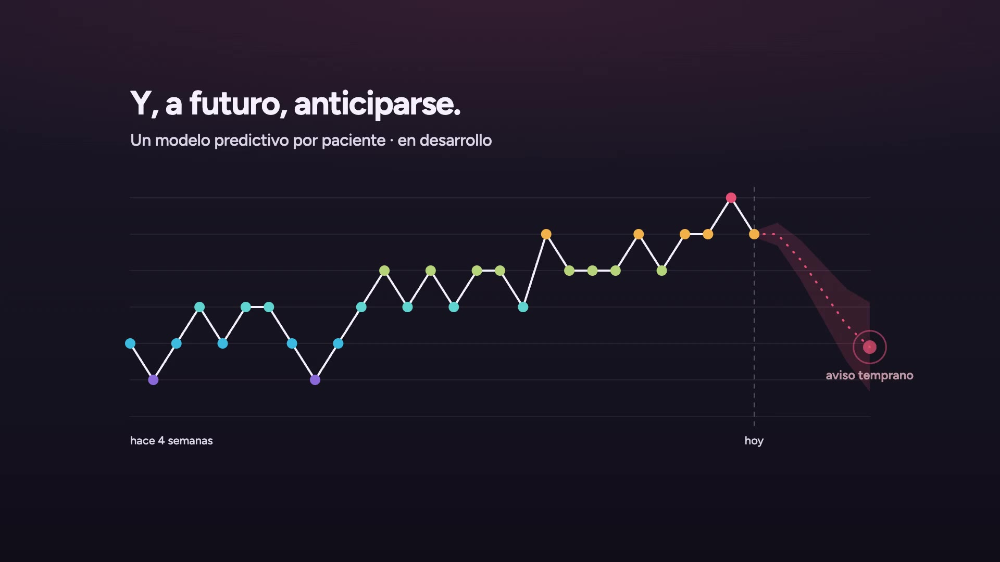
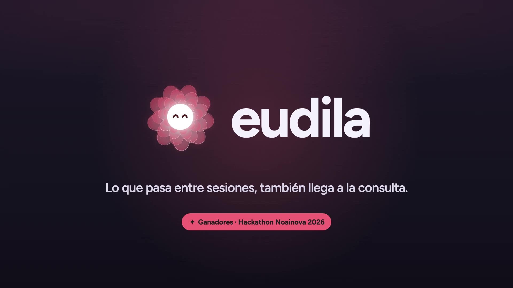
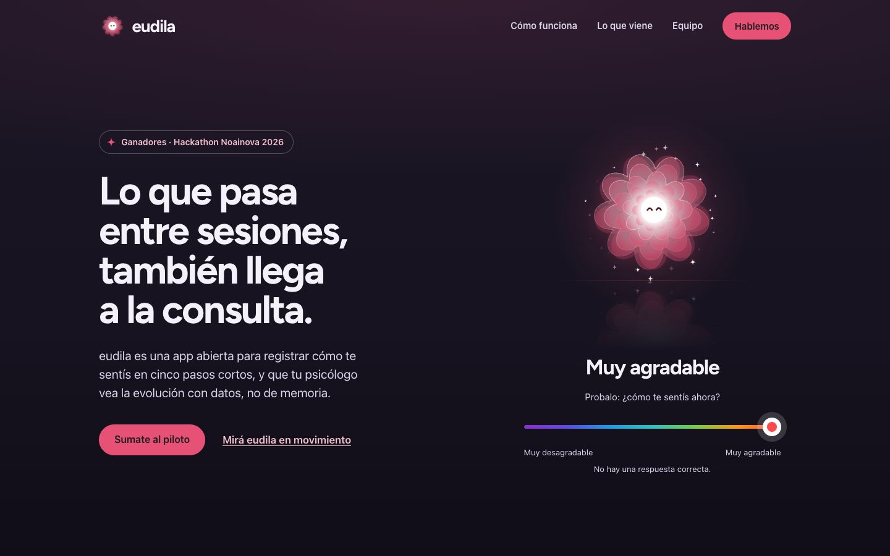
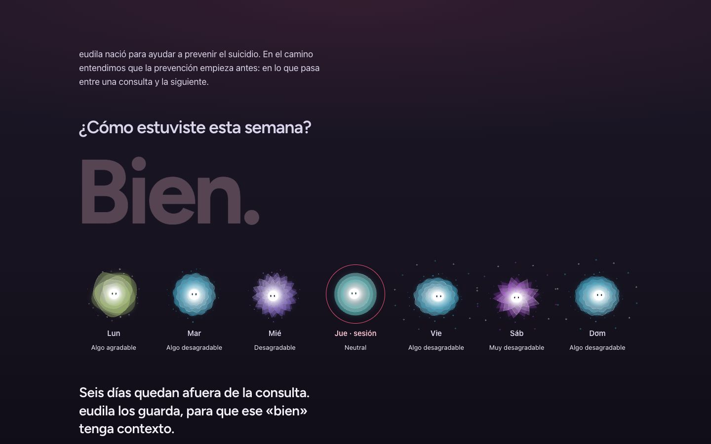
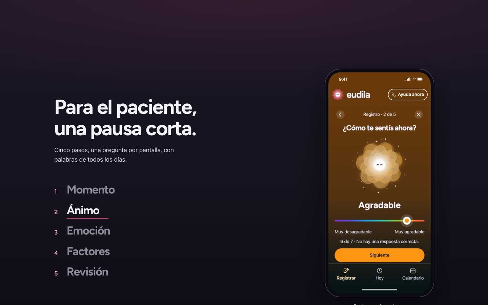
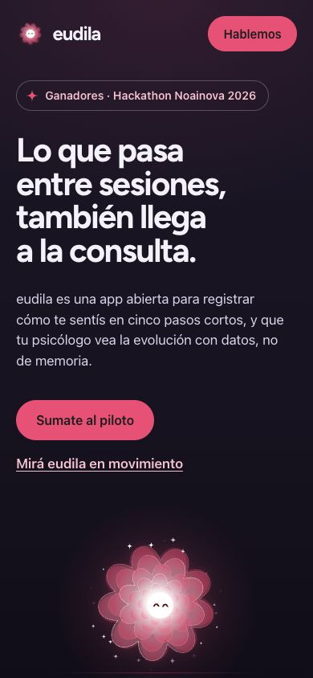
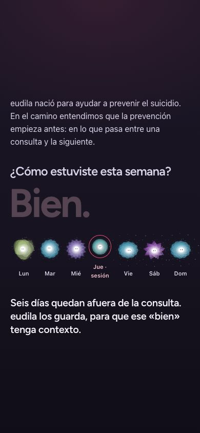

# Landing en movimiento · 26/10/2026

Rediseño de `landing/` sobre la rama `codex/ani-76-81-entrega`, trabajado en `147pop/landing-showreel`. Pedido del usuario: «con este mismo estilo e información que venimos manejando… animaciones y video… usá el brandbook de eudila, que la landing se sienta viva y mantenela minimalista». Misma narrativa que el pitch del 26/10: público psicólogos e inversión; salen gobiernos y desarrolladores.

Fuentes leídas antes del cambio: `PRODUCT.md`, `DESIGN.md`, `docs/design/mascota/README.md`, tokens de `app/globals.css` y el motor `app/mood/critter.ts`.

## Qué cambió

| Sección | Movimiento | Regla de marca que respeta |
| --- | --- | --- |
| Portada | Mascota Muy agradable con Saludo, reflejo de espejo con onda lenta y el selector de siete estados de la app. Si nadie lo toca, recorre el péndulo de la Apertura (4 → 3 → 5 → 2 → 6 → 1 → 7) con la curva de marca de 600 ms. | El selector es la única entrada; tocarlo apaga el péndulo. Escucha mira hacia el selector, nunca al pulgar. La luz es del orbe. |
| La semana | Scroll fijado: «¿Cómo estuviste esta semana? Bien.» y siete días con «?» que se revelan como mascotas con el estado real; el «Bien.» se apaga. | Siete mascotas, cada una con su reloj. Sin JavaScript se leen los estados; con movimiento reducido la semana aparece completa y quieta. |
| Video | Pieza de 32 s renderizada cuadro a cuadro (ver abajo). Mudo; se reproduce solo cuando se ve. | Con movimiento reducido no arranca sola. Descripción textual en «Qué muestra el video». |
| Paciente | Las cinco capturas reales del registro avanzan cada 2,8 s mientras se ven; barra de progreso en el paso activo; cada paso es un botón. | Tocar un paso detiene el avance. |
| Psicólogo | Gráfico SVG de 28 días que se dibuja una vez al entrar. | Datos ficticios declarados. Sin JavaScript el gráfico ya está completo. |
| Lo que viene | Pulso cardíaco, mascota que celebra cada 5,5 s y proyección punteada con aviso. | Logros por registrar, nunca por sentirse bien: Guardado igual en cualquier estado. |
| Noainova | Guardado al entrar en pantalla; tocarla la hace saltar. | El toque es reacción, no seguimiento. |

El header usa el logo estático (`logo.svg`), según la decisión del 26/10 del README de la mascota. El pie incluye los teléfonos de Ayuda de `docs/content/ayuda.md`, porque la página menciona la prevención del suicidio.

## La pieza de video

`landing/film/pelicula.js`, 1920 × 1080, 60 fps, 32 s, 3,6 MB (H.264, CRF 21). Determinista: cada mascota tiene un reloj sembrado y los momentos se disparan por número de cuadro.

1. Chispa (0–3,4 s): el núcleo cae en espiral con una estela de los siete colores.
2. Florece en Neutral y recorre el péndulo con el selector y el ambiente de cada estado (3,3–10,9 s).
3. Los siete suben desde su lugar en el selector y quedan en fila: «Siete estados. Ninguno es el correcto.» (10,5–14,9 s).
4. Cada registro nace de la mascota de su estado y viaja a su día: cuatro semanas, la línea se dibuja y una proyección punteada anticipa una baja con «aviso temprano», rotulada «en desarrollo» (14,9–21,3 s).
5. Los puntos se funden en un núcleo; la mascota, en Algo desagradable, celebra el registro: «Celebra que registraste, nunca cómo te sentís.» (21,7–25,3 s).
6. Pasa al coral de marca y arma el lockup: `eudila` sale de atrás del orbe, la frase «Lo que pasa entre sesiones, también llega a la consulta.» y el sello de ganadores del Hackathon Noainova 2026 (25,5–31,3 s).

## Capturas

## Ajustes del mismo día

- **Título:** a pedido del usuario, la portada, el título de la página, la imagen social, el cierre del video y el pitch usan «Lo que pasa entre sesiones, también llega a la consulta.» en lugar de «Un espejo tranquilo para cada estado de ánimo». El lema de marca de `PRODUCT.md` y la app no cambiaron.
- **Teléfono:** las capturas iban de borde a borde y las esquinas redondeadas cortaban «Ayuda ahora», el logo y «Calendario». Ahora `scripts/capture-app.cjs` captura el área útil (390 × 763) y suma barra de estado e indicador de inicio con el color de cada borde (390 × 844). El marco tiene bisel y radios concéntricos (pantalla al 12 % del ancho; marco = pantalla + bisel). El pitch usa la misma composición.

## Verificación

- `npm test`: 6 pruebas del contacto, pasan.
- `npm run check:visual`: 6 reflujos (320/390/768/1440 px y 320/390 px con texto al 200 %), sin desborde, imágenes rotas ni errores de consola; formulario 2xx limpia y 502 conserva datos. El chequeo ahora pide las imágenes diferidas antes de evaluarlas y cierra el navegador si falla.
- Teclado: flechas, Inicio y Fin recorren los estados con la curva de marca y anuncian `aria-valuetext`; después de usarlo el péndulo no vuelve.
- Movimiento reducido: mascotas quietas, semana completa sin scroll fijado, video sin reproducción automática, sin animaciones CSS.
- Revisión visual por sección en Chrome a 1440 × 900 y 390 × 844.

## Límites

- La captura «Guardar en vista previa» es la app en modo vista previa; la landing no promete sincronización de registros.
- Panel profesional, integración con Apple Health y Samsung Health, gamificación y modelo predictivo figuran como «Próximo» o «Largo plazo»: no existen en el código.
- Pendientes externos de ANI-76 sin cambios: dominio, casilla monitoreada, Resend, Umami y prueba de envío real.
