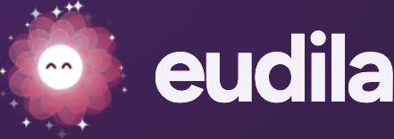

# Mascota eudila · branding vigente desde el 23/10/2026

**Estado:** decisión de marca aprobada por el usuario el 23/10/2026 («hacé que esta sea el nuevo branding de eudila»). Reemplaza al logo Neutral estático y a la regla anterior que descartaba cualquier cara. **Implementada en la app Next.js desde el 24/10/2026** (VIS-13 a VIS-17 resueltas en [la revisión de marca](../brand-review-2026-10-04.md)): motor canvas `app/mood/critter.ts` y componente `app/mood/mascota.tsx`; `app/mood/orb.tsx` queda como «Orbe vivo» estático y fallback sin JS. Si cambia un valor, cambiarlo acá primero y después en el motor.

Fuentes, en orden de autoridad:

1. Este documento: reglas y parámetros.
2. [`eudila-viva.html`](eudila-viva.html): referencia viva. Es el código exacto de la mascota (canvas 2D, sin dependencias). Abrirlo en un navegador y usarlo para medir y comparar. Se publica también en https://eudila.agustinpedernera.com (hosting en el VPS Oracle, `~/Documents/VPS/Oracle/eudila/README.md`).
3. [`public/brand/logo-mascota.svg`](../../../public/brand/logo-mascota.svg): logo principal estático, generado con la misma geometría.
4. [Capturas](capturas/) de referencia.

Si este documento y la referencia viva difieren, manda este documento y hay que corregir la referencia.

## Qué es

La mascota **es el orbe**, no un personaje aparte: cinco capas translúcidas, núcleo blanco y las siete siluetas de `prototype/moods.js`, con los colores de la tabla de estados de [DESIGN.md](../../../DESIGN.md). La personalidad sale del movimiento y de una carita mínima dentro del núcleo. No se le agregan brazos, cuerpo, boca, cachetes, accesorios ni ilustraciones.

## Logo principal

- **Estado:** Muy agradable (flor de nueve pétalos, orbe `#E65175`). El usuario eligió «el más alegre» como logo. Es identidad de marca, no una respuesta al ánimo de la persona: no cambia con su registro.
- **Carita:** ojos felices en arco (`^ ^`) sobre un núcleo blanco agrandado. **Sin cachetes**: se probaron y el usuario los rechazó.
- **Detalle:** sin destellos alrededor, a pedido del usuario el 24/10/2026; antes llevaba los destellos de los estados agradables a 2,4×. Las cinco capas de pétalos con giros alternos.
- **Lockup en header:** símbolo animado en una caja de 72 px (orbe visible ≈ 49 px) + wordmark `eudila` Figtree 700, `2.25rem`, tracking −0.045em, en minúsculas. El símbolo queda a la izquierda.
- **Decisión del 26/10/2026:** el logo del header es la imagen estática `logo-mascota.svg`: quieto, sin saltos, sin destellos y sin reacción al toque, en todas las pantallas. Reemplaza el movimiento descrito a continuación, que ya no aplica al header (la mascota viva sigue en ánimo, splash, estados vacíos y Ayuda).
- **Movimiento del logo (histórico):** respira, gira las capas, parpadea, da saltitos ocasionales (temperamento Muy agradable) y mira a los costados por su cuenta. Al tocarlo salta y se sacude. Con movimiento reducido queda quieto.
- **Mascota por defecto (24/10/2026):** donde la mascota representa a eudila y no un ánimo (inicio, bienvenida, Ayuda y estados vacíos), es la Muy agradable coral, igual que el logo (`brandMood` en `app/mood/critter.ts`). Neutral ya no la identifica: es uno de los siete estados. Guardado usa el ánimo registrado y el slider el ánimo elegido. En Descanso no salta ni se balancea.
- **Estático** (favicon, documentos, impresión, sin JS): `public/brand/logo-mascota.svg`. Se lee de 24 px en adelante ([tamaños](capturas/logo-svg-tamanos.png)).
- `public/brand/logo.svg` (Neutral sin cara) es la versión histórica; desde el 24/10 la app usa la mascota (VIS-13 cerrada).

## Reglas que no se negocian

1. **Nunca sigue al puntero, ni directa ni indirectamente.** Sin mirada hacia el mouse, sin saltos al pasar por encima (hover), sin mirar al pulgar del slider. La mirada es autónoma. La única entrada del puntero es el toque o clic, que dispara una reacción (salto o sacudida).
2. **Movimientos independientes.** Cada mascota tiene su propio reloj: fase aleatoria de 0 a 20 s para balanceo, saltitos, tiritona y destellos; fase de respiración y de giro aleatorias; parpadeo y cambios de mirada con tiempos propios (el primero entre 0 y 2,5 s). Dos mascotas en pantalla nunca se mueven sincronizadas.
3. **Neutral tiene tres capas.** Las dos capas interiores (escalas .52 y .36) no se dibujan en Neutral. Su opacidad es `clamp(|ánimo − 4| × 1,5)`: aparecen gradualmente al alejarse de Neutral (completas a ±0,67), para no saltar durante el arrastre. Vale para el orbe y la mascota.
4. **Sin juicio.** Guardado celebra igual en los siete estados: celebra que registraste, no cómo te sentís. En lo desagradable la mascota se vuelve más lenta y pesada, nunca castigada. La tiritona máxima es 1,1 px a radio 110.
5. **Movimiento reducido:** mascota quieta (sin respiración, giro, titileo, parpadeo ni mirada), cambios instantáneos, momentos omitidos.
6. **Dónde vive:** viva (con movimiento) en el logo, la pantalla de ánimo, el splash, los estados vacíos y Ayuda. En historial, tarjetas, fichas y listas aparece **quieta con su carita** (24/10/2026, pedido del usuario: «que el eudila con los ojos aparezca de forma consistente en todas las pantallas»). Usa los mismos ojos por estado, sin parpadeo, mirada ni respiración, y en tamaños compactos la cara va agrandada ×1,75 como en el logo (`MoodOrb compact`). La regla de movimiento de DESIGN.md sigue vigente.

## Construcción

Unidades locales: el orbe mide 220 (radio 110). La referencia escala todo con `K = radio en px / 110`.

| Parte | Valor |
| --- | --- |
| Capas | escalas `[1, .84, .68, .52, .36]`, opacidad de relleno `.6 + i × .065`, borde `.8 / escala` |
| Material | radial en (−4.4, −8.8), r 132: blanco .76 → blanco .28 (34%) → orbe .62 (72%) → orbe .38 |
| Borde de luz | radial en (−26.4, −57.2), r 187: blanco .76 → orbe .30 |
| Halo | silueta exterior con desenfoque, orbe al 38–45% |
| Giro | capas alternas en sentido opuesto, desfase .55 rad por capa, 0,05 rad/s |
| Núcleo sin cara | resplandor r 53 + círculo blanco r 12 |
| Núcleo con cara | resplandor r 53 + disco blanco r 22 (logo: ×1,75) |
| Paralaje de mirada | capa i se desplaza `(1 − escala) × 14`, núcleo 16, ojos +3 / +2,4 |
| Partículas | 24 en ángulo áureo, radio 98–114. Desagradables: puntos del color del orbe. Agradables: destellos blancos. Neutral: ninguna |

### Ojos

| Parámetro | Valor |
| --- | --- |
| Tamaño | elipse 4,8 × 9,4, separación ±7,6 desde el centro del núcleo |
| Tinta | ambiente del estado mezclado con 35% de negro (Muy agradable: `#491519`) |
| Desagradable | párpado más bajo del lado externo: `clamp((3,6 − ánimo) / 2,2) × .9` |
| Agradable | arcos `^` desde Agradable: `clamp((ánimo − 5,5) / .5)`, trazo 2,6 |
| Descanso | arcos cerrados hacia abajo |
| Parpadeo | 160 ms, cada 2,4–6,2 s al azar |
| Mirada | cambia cada 1,1–3,3 s; 30% de las veces al centro; amplitud x .6, y .4; suavizado exponencial 11/s |

## Temperamentos

Interpolados con la posición continua del slider.

| Estado | Respiración | Amplitud | Otro rasgo |
| --- | --- | --- | --- |
| Muy desagradable | 5,6 s | ±1,2% | se hunde 6%, tiritona 1,1 |
| Desagradable | 5,0 s | ±1,4% | se hunde 3,5%, tiritona .6 |
| Algo desagradable | 4,5 s | ±1,6% | se hunde 1,2%, tiritona .15 |
| Neutral | 4 s | ±1,8% | tres capas, quieto |
| Algo agradable | 4 s | ±2,0% | ondulación radial de 8 s (ya en la app), balanceo 1,2° |
| Agradable | 3,6 s | ±2,4% | balanceo 2,4° (período 3,4 s) |
| Muy agradable | 3,2 s | ±2,8% | balanceo 3,6°, saltito de 7% del radio cada 3,2 s |

## Momentos

| Momento | Dónde | Duración | Coreografía |
| --- | --- | --- | --- |
| Saludo | splash, inicio | 2,3 s | núcleo aparece con rebote; capas de adentro hacia afuera, 70 ms entre capas, `backOut(1.9)`; salto a 1 s; guiño a 1,75 s |
| Escucha | mientras arrastrás el slider | continuo + 0,9 s | se agacha 4%, mira hacia abajo, tres ondas cada 0,5 s que crecen 64 unidades en 1,5 s |
| Guardado | confirmación del registro | 2,1 s | inspira +6% (180 ms); capas al núcleo con ease-in, la exterior primero; destello del núcleo; reapertura con rebote; ojos felices; 14 destellos radiales |
| Descanso | historial vacío, de noche | hasta apagarlo | respiración al doble del período, ojos cerrados, se hunde 5%, partículas al 15%, brillo 70% |
| Ayuda | primer uso de Ayuda | 3 s | asoma desde abajo con la curva de marca, mira a izquierda, derecha y arriba, sube de un salto |
| Toque | al tocarla | 1,2 s | resorte de 3,1 Hz, amortiguación 4,2, ±11% |
| Apertura | onboarding (`/empezar`), una vez por sesión (cookie de sesión `eudila-intro`) | 11,45 s, saltable (botón o Esc) | `app/empezar/intro.tsx` (26/10/2026, segunda versión; la anterior en la rama `147pop/intro-sonnet`). Empieza y termina en el logo del header: lo reemplaza en el mismo cuadro, guarda el wordmark dentro del orbe y se pliega a su núcleo (0–0,86 s); el núcleo cae en espiral con una estela de los siete colores (hasta 2,2 s); florece en Neutral y hace un péndulo hacia ambos lados, un estado por pulso de 600 ms con la curva de marca: 4 → 3 → 5 → 2 → 6 → 1 → 7, con su nombre y el slider en miniatura (hasta 6,4 s); los siete suben desde su lugar en el slider y quedan en fila, mismo tamaño y reloj propio cada uno, sobre un reflejo (hasta 7,95 s); se funden en un núcleo con un anillo por estado, un respiro en silencio, y florece el coral de marca con salto (8,6 s); arma el lockup con `eudila` saliendo de atrás del orbe y el lema (9,4–10,6 s); el lockup vuelve al header y el formulario aparece escalonado (10,6–11,45 s). El giro de capas aterriza en el ángulo del SVG. Usa `Critter.scene` (pose guionizada), `still` (apaga respiración y temperamento para la pose del logo) y `spinA`. Nunca lee el puntero. Movimiento reducido: se omite (también por CSS, sin esperar al script). [Evidencia](../evidence/apertura-2026-10-26/README.md). |
| Salto | base de otros momentos | 1 s | anticipación 140 ms (−10% alto), aire 320 ms (+8% alto, 22% del radio), aterrizaje con resorte de 3 Hz |

El aplastamiento siempre apoya en el piso (la base de la mascota no se mueve al aplastarse).

## Direcciones exploradas

La referencia conserva cuatro direcciones. **Vigente:** mascota con carita («Mirada») en todas las representaciones; desde el 24/10/2026 también las compactas llevan cara (quieta).

- **Orbe vivo:** sin cara. Ya no se usa en la app (24/10/2026); las representaciones compactas llevan la carita quieta.
- **Mirada:** con carita. Logo, ánimo, Ayuda, onboarding, TechWeek.
- **Chispa:** el núcleo viaja con una estela del espectro y florece en un estado. Candidata para el splash (VIS-09).
- **Tu eudila:** avatar con los últimos cinco registros, una capa por ánimo. Requiere persistencia real y es **privado por defecto**, porque revela ánimo.

## Implementar en la app

- Hecho el 24/10/2026 con un componente canvas compartido (`app/mood/mascota.tsx` sobre `app/mood/critter.ts`), un solo `requestAnimationFrame` para todas las mascotas y la geometría de `prototype/moods.js`.
- Ubicaciones: logo del header, `/registro/animo` (temperamentos y Escucha), Saludo en `/` y `/bienvenida` (una vez por sesión), Guardado en `/hoy` tras guardar, Descanso en los vacíos de Hoy y Calendario (de noche), Ayuda en el primer uso de `/ayuda`.
- Mantener las reglas de arriba y las pruebas existentes de movimiento reducido, pausa al ocultar y AA.
- Al cerrar cada brecha, agregar evidencia en `docs/design/evidence/` y actualizar este documento si cambia algún valor.
